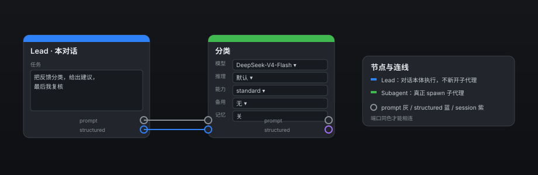

# DSH Workflow Canvas

A Blender-style node canvas for orchestrating DSH agents, docked in the right
sidebar. Draw a graph, enable it, and ask the agent to run it — subagent nodes are
spawned for real, Lead nodes pause the run and are performed by the conversation
itself.



## 中文简介

在右侧栏画一张流程图来编排 DSH 的子代理：子代理节点会被真实启动，Lead 节点则由对话本体执行。
画布可以保存为预设、跨会话复用，也能由模型直接生成或就地修改。

---

## Nodes

- **Subagent node** (green top bar) — spawns a child agent. Each node sets its own
  model, reasoning effort, capability scopes (`standard` / `minimal`), fallback
  model, memory and role.
- **Lead node** (blue top bar) — performed by the conversation, never spawned.
  The entry Lead carries the overall task; the run stops at every Lead step and
  resumes with your answer.

## Links

| Type | Colour | Carries |
|---|---|---|
| `prompt` | grey | plain text |
| `structured` | blue | a JSON object; the upstream node is asked for structured output automatically |
| `session` | purple | the upstream child session, so the downstream runs **inside it** |

Drag from a right socket to a left socket, or from a left socket to a right one.
Drag a connected left socket away to detach. Hold the **right button** and sweep
across links to cut them (toggle in `⋯`).

## Running

1. Write the task in the entry Lead, and a role for each node.
2. Connect the nodes — unlinked nodes are dashed and skipped.
3. Press the **● 已启用 / ○ 已禁用** pill over the canvas, then ask in chat to run it.
4. The run proceeds in parallel waves (up to 4 at a time) and pauses at each Lead
   node with the results collected so far.

## Lead handover

When a `session` link points into a Lead node, the run reports that child session
id at the Lead step, so the conversation can keep talking to that agent instead of
only receiving its text.

## Generating and editing the canvas from chat

- `canvas_generate` — build a whole canvas from a node/edge sketch (replaces it).
- `canvas_patch` — edit it in place: update nodes by id, add or remove nodes and
  links, leaving positions and everything else untouched.

Both write the canvas to the workspace, and the panel picks it up within ~1.5s.

## Presets

Name a canvas and press `☆ Save`; load it in another session from `☰ Presets`.
Presets live in browser storage, shared across sessions of the same origin, and
are not synchronised across machines.

## Memory

A node with memory on reuses its child session: within a run, across runs in the
same session, and — through the persisted child id — after a restart, where the
Host cold-resumes it. A resume the Host refuses is forgotten and the node starts
fresh.

## Limits

- Presets do not travel between the Desktop app and `dsh web`, nor across machines.
- Node status is read from the subagent catalog, so Lead steps show **由对话执行**
  instead of a tracked state.
- Up to 4 nodes run at a time.

## Development

Edit `client.js` / `index.js` and reload the app; client changes hot-reload, Host
changes need a restart. See [docs/DETAIL.md](docs/DETAIL.md) for the internals.

## Making the agent use this plugin

The bundled guide ships as a skill named `workflow-canvas`. DSH has no
"auto-load" switch: the model sees each skill's **name and description** in its
catalogue and loads the body on demand. Three things make it reliable:

1. **A description that names the trigger words** — canvas, workflow, pipeline,
   node graph, 画布, 工作流, 编排. It already does.
2. **Pointers from the tools** — every `canvas_*` tool description tells the
   model to load the skill first, and tools are always in context.
3. **A line in your project's `AGENTS.md`** — the strongest option, because it is
   always loaded:

```markdown
When a task involves the workflow canvas (画布 / 工作流 / 编排) or the canvas_*
tools, call the `skill` tool with name `workflow-canvas` first.
```

Add that to the workspace `AGENTS.md` once per project and the agent will load
the guide without being asked.

## License

MIT — see [LICENSE](LICENSE).
