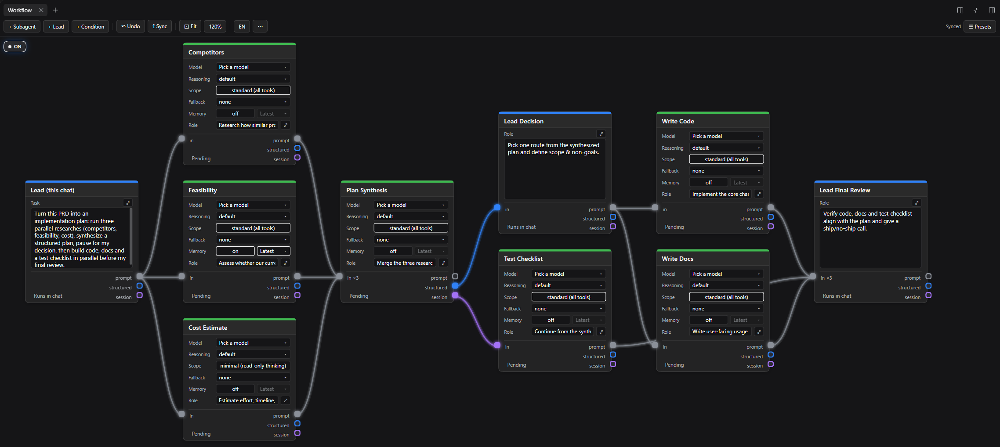
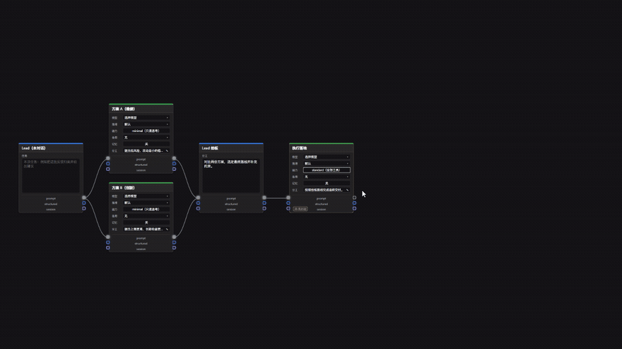
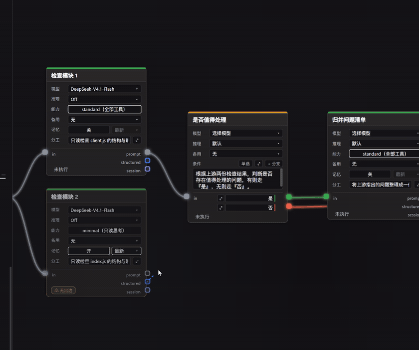
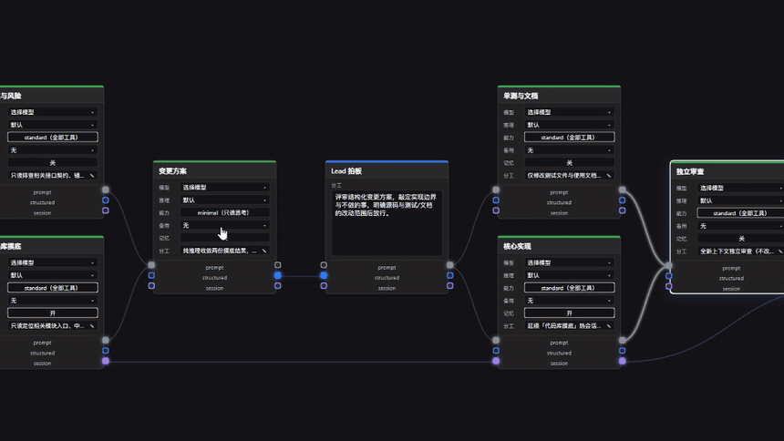
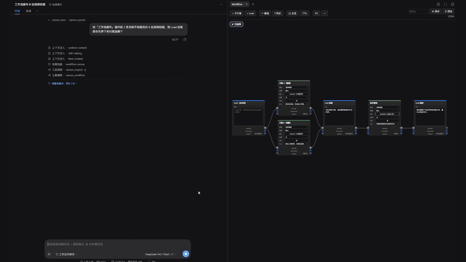
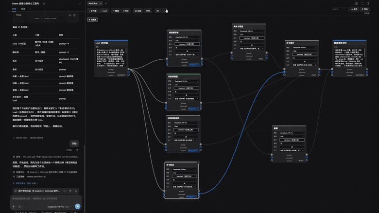

# DSH Workflow Canvas

English | [中文](README.zh.md) | [Mechanism & Architecture](docs/MECHANISM.md)

Turn multi-agent orchestration in DSH into a visual node graph: each card is an AI role, each wire defines who feeds whom, and pressing **● ON** lets you run the whole pipeline straight from chat.

- **Real parallelism**: Independent nodes run concurrently (up to 4 at once), and newly unblocked downstream nodes start the instant their inputs finish.
- **Human-in-the-loop**: Drop a **Lead** card anywhere in the flow to pause automatically for your decision before continuing.
- **Zero black box**: Click any subagent card to open its live chat transcript and inspect its exact output.
- **Don't want to draw by hand?** Describe the workflow in one sentence in chat — the agent sketches the graph for you and can patch it in place anytime.

## Installation

Requires DeepSeek Harness **0.2.2** or newer (`engines.dsh: ">=0.2.2-rc.1 <0.3.0-0"`).

- **From the plugin market** — open **Plugins → Discover**, search *"workflow canvas"*, and install ([catalog PR #17180](https://github.com/awesome-dsh-plugin/awesome-dsh-plugin/pull/17180)).
- **From npm** — install `dsh-workflow-canvas` from the **Plugins** panel or via `plugin_manager` / `dsh` CLI (`install_bundle`).
- **From source** — clone this repo and install it via **Plugins → Add plugin** pointing at the local folder.

Once enabled, open the **`Workflow`** tab in the right sidebar.

---

## How to use it (5-step visual guide)

### 1. Place cards (or load a starter template)

There are only two card types:
- **Subagent (green top bar)**: A real child agent that does a focused job.
- **Lead (blue top bar)**: Your main chat conversation. The leftmost entry Lead holds the overall task; an intermediate Lead **pauses the run for your decision**; a terminal Lead delivers the final review in one shot.

Start fastest by loading a built-in template from **`☰ Presets`**, or press **`Shift+A`** anywhere on the canvas to drop a new card (`⋯` also provides `⊞ Auto layout` and `✕ Clear canvas`):

---

### 2. Wire the flow (left feeds right)

**Drag from a right-side dot on an upstream card to a left-side dot on a downstream card** to pass results forward.

Dot colour is the channel type — **only matching colours connect**:
| Colour | Socket | Plain-English meaning |
|---|---|---|
| Grey | `prompt` | **Pass text**: sends the upstream summary as plain text |
| Blue | `structured` | **Pass JSON**: automatically asks the upstream node for a JSON object |
| Purple | `session` | **Continue the same chat**: the downstream step runs inside the upstream child session (no re-scanning context) |

- **Disconnect a link**: **Hold right-click and sweep across any wire** to cut it (or drag a connected left dot away).
- **Dashed cards = inactive (skipped)**: Unreachable nodes, solo chained Lead nodes with no subagent upstream, and dangling dead-end subagents automatically turn **dashed** and are skipped at run time so you never waste tokens.

---

### 3. Configure each card independently (optional)

Every subagent card can carry its own settings:
- **Model & Reasoning**: Pair fast models for routine tasks with stronger models for synthesis/review.
- **Scope**: `standard` (all tools) or `minimal` (read-only thinking — disables file edits and web). *Bounded by the main chat's permission mode.*
- **Fallback**: Automatically retries once on another model if the primary one fails.
- **Memory**: Reuses this node's previous child session across runs and restarts.

---

### 4. Toggle `● ON` and send your task in chat

Press **`● ON`** at the top-left of the canvas, then just send your task in chat — no magic phrasing needed (while enabled, a per-session runtime context automatically notifies the agent):

- You can leave the entry Lead's task blank: your chat message is passed automatically as `task`.
- At an intermediate **Lead** card, the canvas lights up **`⏸ Ready`** and hands control to you in chat; once you reply with your choice, downstream nodes resume automatically through the final Lead review.
- To run again in the same chat: pass `reset: true`; if any node has **Memory** enabled with prior history, the agent asks whether to keep memory or start fresh (`clearMemory: true`).

---

### 5. Click any card to watch its live subagent chat

Active nodes glow blue with animated flow wires and turn green when done. **Click the status badge (`Running ↗` / `Done ↗`) at the bottom-right of any subagent card** to jump straight into its own conversation pane:

---

## Let the agent draw or edit the canvas from chat

- **Sketch from one sentence** (`canvas_generate`): *"Build a parallel research workflow on the canvas: two subagents investigate competitors and feasibility, pause for me to decide, then write the plan."*
- **Patch in place** (`canvas_inspect` + `canvas_patch`): *"Inspect the current canvas, turn Memory on for feasibility, and add a read-only cost-estimate node wired into plan synthesis."* (Preserves your layout.)

## Shortcuts & controls

| Control / Shortcut | Action |
|---|---|
| `Shift+A` | Add a node at the cursor (`1` = Subagent, `2` = Lead) |
| Middle-drag / `Space` + left-drag | Pan the canvas |
| Wheel / `⊡ Fit` / `100%` pill | Zoom around cursor / fit all nodes / click to reset 100%, drag left-right to scrub zoom |
| Marquee drag + `Ctrl+D` / `Delete` | Multi-select move, duplicate (with settings), or batch delete |
| Right-drag across wires | Cut links (toggle under `⋯`) |
| `Ctrl+Z` / `Esc` | Undo structural edit / close popups |
| `⋯` menu | Import / Copy JSON, Auto layout, Clear canvas, Visual effects (Minimal / Standard / Vivid) |

## Presets, sharing & limits

- **Presets & sharing**: `☰ Presets` includes 3 starter templates plus **New blank canvas**; save your own with `☆ Save`. Custom presets live in browser storage — use `⋯ → ⇧ Copy JSON` and `⇩ Import` to share across devices.
- **How this differs from other canvas plugins**: Built for **multi-subagent orchestration + conversation Lead gates**; for `ctx.workflows` tool/condition pipelines, see [`@piedpiper911/dsh-workflow-canvas`](https://github.com/PiedPiper911/dsh-workflow-canvas).
- **Limits**: Up to 4 subagents run concurrently; per-node `Scope` only narrows tools within the main chat's permission/sandbox ceiling.

## Development & internals

- See [**Mechanism & Architecture**](docs/MECHANISM.md) ([中文](docs/MECHANISM.zh.md)) for the Client ↔ Host bridge, event-driven concurrency pool, link semantics, and cold resume.
- Edit `client.js` / `index.js` and reload (Host changes require restart). Run `npm test` for the test suite. Compact plugin page: [docs/DETAIL.md](docs/DETAIL.md).

## License

MIT — see [LICENSE](LICENSE).
