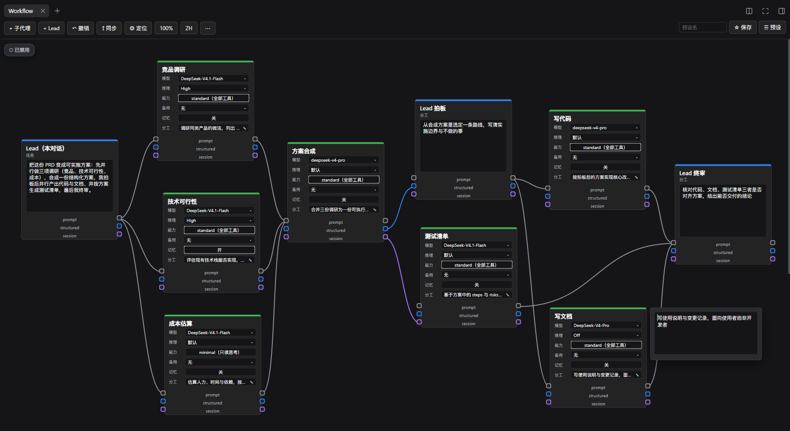

# DSH Workflow Canvas（可视化工作流画布）

一个 Blender 风格的可视化节点画布，用来编排 DSH 的子代理，停靠在右侧栏。
画好流程图、启用，然后让对话去跑——子代理节点会被真实启动，Lead 节点会暂停运行、由对话本体执行。



- [English README](README.md)

## 节点

- **子代理节点**（顶部绿条）—— 真正 spawn 一个子代理。每个节点可单独设置模型、推理强度、能力范围（`standard` / `minimal`）、备用模型、记忆和分工。
- **Lead 节点**（顶部蓝条）—— 由对话本体执行，从不 spawn。入口 Lead 承载总任务；运行每到一步 Lead 就暂停，等你在对话里完成。

## 连线

| 类型 | 颜色 | 传递内容 |
|---|---|---|
| `prompt` | 灰 | 纯文本 |
| `structured` | 蓝 | 一个 JSON 对象；上游节点会被自动要求输出结构化结果 |
| `session` | 紫 | 上游的子会话，下游在**它里面**继续跑 |

从右端口拖到左端口、或从左端口拖到右端口都能连线；拖已连接的左端口可断开。
按住**右键**划过连线可切断（可在 `⋯` 里关掉这个手势）。

## 运行

1. 在入口 Lead 写总任务，给每个节点写分工。
2. 连好节点——未连线的节点会显示虚线并被跳过。
3. 点画布左上角的 **● 已启用 / ○ 已禁用** 浮窗，然后在对话里让它跑。
4. 运行按波次并行（每次最多 4 个），每到一个 Lead 节点就暂停，并把已收集的结果交回。

## Lead 交接

当 `session` 线指向 Lead 节点时，运行会在 Lead 步骤上报那个子会话 id，于是对话可以继续追问那个子代理，而不只是拿到它的文本。

## 从对话生成 / 修改画布

- `canvas_generate` —— 从一个节点/连线草图重建整张画布（替换）。
- `canvas_patch` —— 就地编辑：按 id 更新节点、增删节点和连线，位置和其余内容保持不变。

两者都会把画布写到工作区，面板约 1.5 秒内自动读取。

## 预设

给画布起名后点 `☆ 保存`；在其它会话里从 `☰ 预设` 载入。预设存在浏览器存储里，同源会话共享，不跨机器同步。

## 记忆

开启记忆的节点会复用它的子会话：同一轮运行内、同一会话的多次运行之间，以及——通过落盘的子会话 id——重启之后（Host 冷恢复）。若 Host 拒绝恢复，该记录会被丢弃、节点重新开始。

## 限制

- 预设不在桌面应用和 `dsh web` 之间互通，也不跨机器同步。
- 节点状态读取自子代理目录，因此 Lead 步骤显示 **由对话执行**，而不是一个可追踪的状态。
- 同一时间最多并行运行 4 个节点。

## 让 agent 使用这个插件

内置指南以名为 `workflow-canvas` 的技能发布。DSH 没有「自动加载」开关：模型在技能目录里看到每个技能的**名字和描述**，然后按需加载正文。三件事让它更可靠：

1. **描述里写进触发词** —— canvas、workflow、pipeline、node graph、画布、工作流、编排。
2. **从工具指路** —— 每个 `canvas_*` 工具的说明都提示先加载该技能，而工具永远在上下文里。
3. **在项目的 `AGENTS.md` 里加一行** —— 最稳的办法，因为它每次都会加载：

```markdown
当任务涉及 workflow canvas（画布 / 工作流 / 编排）或 canvas_* 工具时，
先调用 `skill` 工具加载 `workflow-canvas`。
```

## 开发

编辑 `client.js` / `index.js` 后重载应用；客户端改动热更生效，Host 改动需要重启。内部实现见 [docs/DETAIL.md](docs/DETAIL.md)。

## 许可

MIT —— 见 [LICENSE](LICENSE)。
