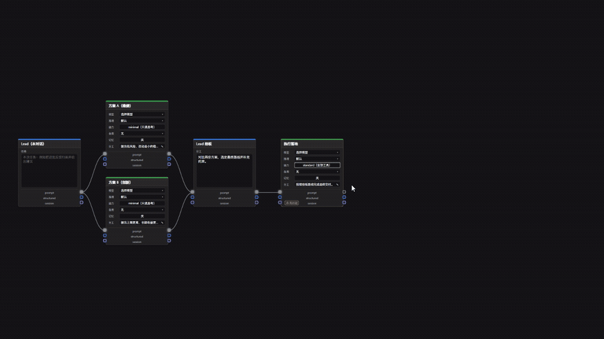
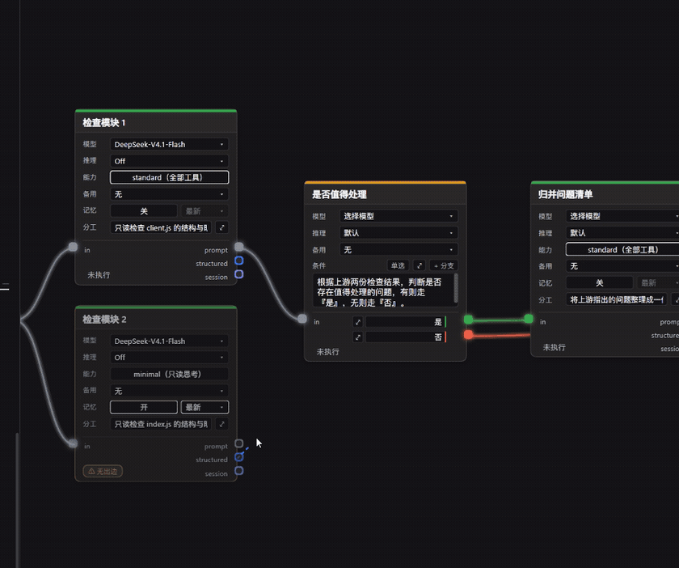
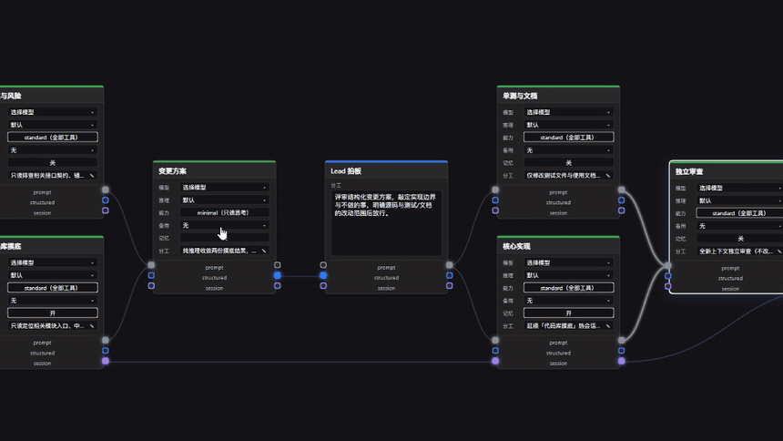
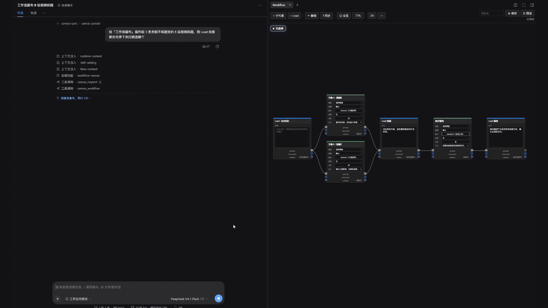
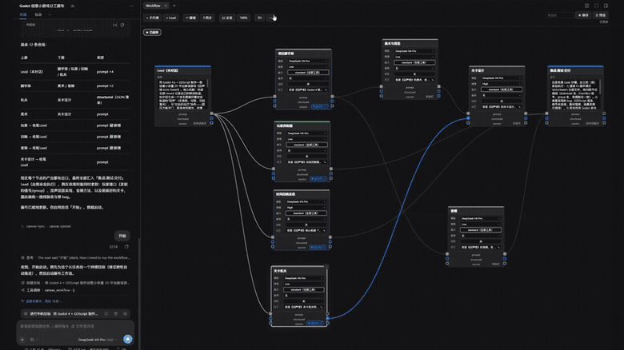

# DSH Workflow Canvas（可视化工作流画布）

中文 | [English](README.md) | [工作机制与架构原理](docs/MECHANISM.zh.md)

把 DSH 的多智能体协作画成一张直观的流程图：每个卡片是一名负责具体工作的 AI，连线决定「谁先做、结果交给谁」，点一下启用就能在聊天里直接开跑。

- **真并行**：互相不依赖的卡片会自动同时开工（最多 4 个并行），跑完一个立刻推进下游，不用干等。
- **人机协同**：在关键节点放一个 **Lead 卡片**，跑到那一步会自动停下来问你拍板，确认后再继续往下跑。
- **完全白盒**：每个子代理的对话记录都能直接点开看，不用猜黑盒里发生了什么。
- **懒得手动画？** 直接在聊天里用一句话描述分工，AI 会帮你把整张图搭好，之后还能随时说一句让它原地修改。

## 安装

需要 DeepSeek Harness **0.2.2** 或更新版本（`engines.dsh: ">=0.2.2-rc.1 <0.3.0-0"`）。

- **从插件市场安装** —— 打开 **插件 → 发现（Discover）**，搜索 *"workflow canvas"* 安装（目录 PR：[#17180](https://github.com/awesome-dsh-plugin/awesome-dsh-plugin/pull/17180)）。
- **从 npm 安装** —— 在 **插件** 面板，或用 `plugin_manager` / `dsh` CLI 的 `install_bundle` 安装 `dsh-workflow-canvas`。
- **从源码安装** —— 克隆仓库后，通过 **插件 → 添加插件（Add plugin）** 指向本地目录即可。

启用插件后，右侧边栏会出现 **`Workflow`** 标签页。

---

## 一眼看懂怎么用（5 步上手）

### 1. 放卡片：决定有哪几个角色（或直接套模板）

画布上只有两种卡片：
- **绿顶「子代理」**：真正干活的 AI，每张卡片是一个独立子代理。
- **蓝顶「Lead」**：就是你正在聊的主对话。最左边的入口 Lead 用来写总任务；放在流程中间的 Lead 会在跑完上游后**停下来等你拍板**；放在末尾的 Lead 负责汇总终审。

不想从零摆卡片？直接点右上角 **`☰ 预设`** 载入现成模板，或者在画布任意位置按 **`Shift+A`** 就能立刻新建卡片（`⋯` 菜单里还提供 `⊞ 自动排版` 和 `✕ 清空画布`）：

---

### 2. 连线定顺序：谁的结果交给谁

**从上游卡片的右边圆点，拖到下游卡片的左边圆点**，就表示「左边干完把结果交给右边」。

端口颜色代表传递方式，**只能同色相连**：
| 颜色 | 端口名 | 传什么（大白话） |
|---|---|---|
| 灰 | `prompt` | **传文字**：把上游的总结文本发给下游 |
| 蓝 | `structured` | **传数据（JSON）**：自动要求上游返回结构化 JSON 给下游 |
| 紫 | `session` | **续聊**：让下游直接在**上游同一个聊天上下文**里接着干（免去重复读文件/重新解释） |

- **连错了怎么断？** 按住**鼠标右键划过连线**就能一刀剪断（也可以直接把左边已连接的圆点拖开）。
- **虚线卡片 = 不会生效**：没从入口连过来的卡片、没连入任何子代理的空串联 Lead、或存在终审 Lead 却没有连出下游的死角子代理，都会自动变成**虚线框**，运行时直接跳过，绝不白烧额度。

---

### 3. 给每个卡片单独配「装备」（可选）

每张子代理卡片都可以独立配置，按需搭配最省钱：
- **模型 & 推理强度**：简单活配轻量模型，核心思考配强模型。
- **能力范围**：`standard`（全部工具）或 `minimal`（纯只读思考，关掉文件读写与联网，防止乱改文件）。*注：受主对话权限上限约束，只收窄、不越权。*
- **备用模型**：这个节点出错时自动换一个模型重试一次。
- **记忆**：打开后，这个节点在下次重跑（甚至重启 DSH）时仍记得上次聊过的内容。

---

### 4. 点亮 `● 已启用`，直接发任务开跑

连好图后，点画布左上角的 **`● 已启用`**，然后像平时一样在聊天框里直接发任务就行（不需要额外写“请调用画布工具”——启用状态会自动通知主对话）：

- 入口 Lead 的任务栏可填可不填：留空时，你在聊天框发的那句话会自动作为总任务传进去。
- 跑到中间的 **Lead 拍板** 时，画布会亮起 **`⏸ 待拍板`** 并把结果交给你选；你回复一句拍板方向，下游立刻自动续跑到 **Lead 终审** 一步交付并全绿收尾。
- 同一对话里如果想重跑：支持 `reset: true` 从头来；若画布里有开启「记忆」的节点，Agent 会先简短确认要保留记忆还是清空记忆（`clearMemory: true`）。

---

### 5. 随时点开看每个子代理在干嘛（真并行、全白盒）

运行中，正在干活的卡片会亮蓝光、连线会出现流动效果，完成后变绿。**直接点击任意子代理卡片右下角的 `进行中 ↗` / `已完成 ↗`**，就能立刻打开它独立的对话窗格，实时查看它的思考和产出：

---

## 用对话让 AI 帮你画图 / 改图

除了手动拖拽，你也可以直接对聊天框说：
- **一句话搭图**（`canvas_generate`）：*「帮我在工作流画布里搭一个并行调研流程：两个子代理分别做竞品和技术可行性，再让我拍板，最后写方案」*
- **原地微调**（`canvas_inspect` + `canvas_patch`）：*「看一下当前画布，把技术可行性开启记忆，再加一个只读成本估算节点并行连到方案合成」*（不会打乱你摆好的位置）

## 常用快捷键一览

| 操作 / 快捷键 | 效果 |
|---|---|
| `Shift+A` | 在鼠标位置新建节点（按 `1` 加子代理，`2` 加 Lead） |
| 鼠标中键拖拽 / `Space` + 左键拖拽 | 平移画布 |
| 滚轮 / `⊡ 全览` / `100%` 按钮 | 光标处缩放 / 一键居中看全图 / 点击回 100%，左右拖可连续缩放 |
| 左键框选 + `Ctrl+D` / `Delete` | 批量移动、批量复制（连同参数配置）或批量删除 |
| 右键按住划过连线 | 切断连线（可在 `⋯` 菜单开关） |
| `Ctrl+Z` / `Esc` | 撤销上一步改动 / 关闭菜单弹窗 |
| `⋯` 更多菜单 | 导入 / 复制 JSON、自动排版、清空画布、切换三档视觉效果（极简 / 标准 / 炫酷） |

## 预设、分享与限制

- **预设与分享**：`☰ 预设` 内置 3 套开箱即用模板和「新建空白画布」；输入名字点 `☆ 保存` 存为自己的预设。自定义预设保存在本地浏览器存储中，跨设备分享请用 `⋯ → ⇧ 复制 JSON` 与 `⇩ 导入`。
- **与其它画布插件的区别**：本项目专注**多子代理编排 + 对话本体拍板**；如果你需要的是把工具调用/条件分支编译为 `ctx.workflows` 的管线，可看 [`@piedpiper911/dsh-workflow-canvas`](https://github.com/PiedPiper911/dsh-workflow-canvas)。
- **运行限制**：同时最多并行运行 4 个子代理；子代理的「能力」受主对话权限/沙箱上限约束。

## 开发与原理

- 底层双向同步、并发池调度、三色连线运行时机制与冷恢复详见 [**工作机制与架构原理**](docs/MECHANISM.zh.md)（[English](docs/MECHANISM.md)）。
- 本地开发：改完 `client.js` / `index.js` 重载应用（Host 改动需重启），运行 `npm test` 执行全套单测。插件详情页见 [docs/DETAIL.md](docs/DETAIL.md)。

## 许可

MIT —— 见 [LICENSE](LICENSE)。
