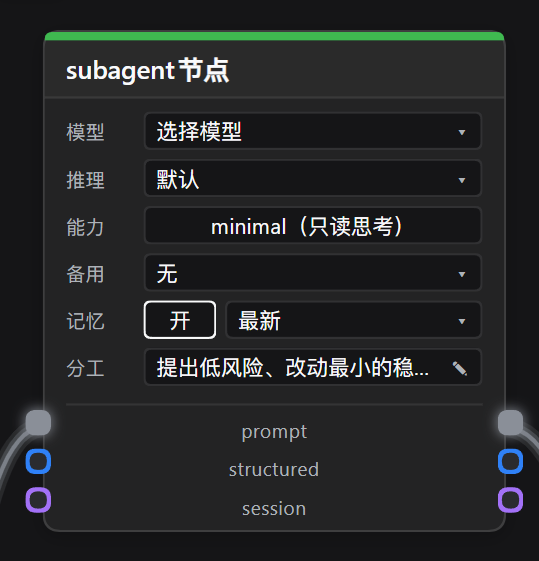
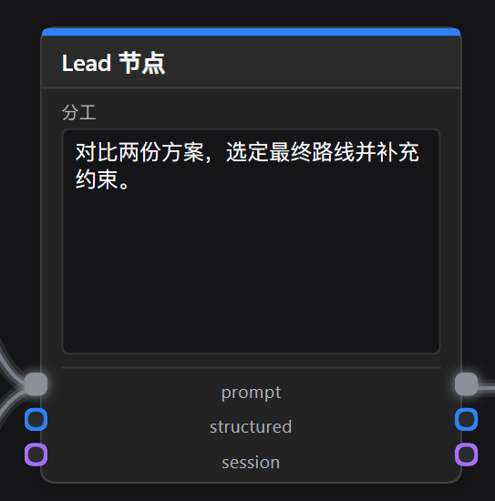

# DSH Workflow Canvas（可视化工作流画布）

中文 | [English](README.md) | [工作机制与架构原理](docs/MECHANISM.zh.md)

把 DSH 的多智能体协作画成一张直观的流程图：每个卡片是一名负责具体工作的 AI，连线决定「谁先做、结果交给谁」，点一下启用就能在聊天里直接开跑。

- **真并行**：互相不依赖的卡片会自动同时开工（最多 4 个并行），跑完一个立刻推进下游，不用干等。
- **人机协同**：在关键节点放一个 **Lead 卡片**，跑到那一步会自动停下来问你拍板，确认后再继续往下跑。
- **完全白盒**：每个子代理的对话记录都能直接点开看，不用猜黑盒里发生了什么。
- **懒得手动画？** 直接在聊天里用一句话描述分工，AI 会帮你把整张图搭好，之后还能随时说一句让它原地修改。

## 安装

需要 DeepSeek Harness **0.2.2** 或更新版本（`engines.dsh: ">=0.2.2-rc.1 <0.3.0-0"`）。

- **从插件市场安装** —— 打开 **插件 → 发现（Discover）**，搜索 *"workflow canvas"* 安装（目录 PR：[#17180](https://github.com/awesome-dsh-plugin/awesome-dsh-plugin/pull/17180)）。
- **从 npm 安装** —— 在 **插件** 面板，或用 `plugin_manager` / `dsh` CLI 的 `install_bundle` 安装 `dsh-workflow-canvas`。
- **从源码安装** —— 克隆仓库后，通过 **插件 → 添加插件（Add plugin）** 指向本地目录即可。

启用插件后，右侧边栏会出现 **`Workflow`** 标签页。

---

## 使用说明

### 1. 节点类型

画布上有三种节点：

| 节点 | 说明 |
|---|---|
|  | **入口 Lead（开始节点，不可删除）** • 整张图的起点，**只有右侧输出口**。 • 「任务」框用于填写本次流程的总目标；也可以留空，开启画布后直接在聊天框发任务即可自动传入。 • 需要参与执行的节点都必须从它连出去。 |
|  | **子代理节点（绿顶，独立子会话执行）** • **模型 / 推理**：可为每个节点单独指定模型和推理强度。 • **能力**：`standard`（全部工具）或 `minimal`（只读思考，关闭文件读写与联网），受主对话权限上限约束。 • **备用**：主模型报错时自动换备用模型重试一次。 • **记忆**：打开 `开` 后可在右侧下拉框选 `最新` 或指定某次历史会话（`#1 / #2`）续接。 • **分工**：点铅笔图标展开填写该节点的具体职责。 |
|  | **Lead 节点（蓝顶，由主对话直接执行）** • **不创建子会话**，直接交回当前主对话完成这一步。 • **放在流程中间**（如 `Lead 拍板`）：上游完成后暂停并亮起 `⏸ 待拍板`，在对话里确认或补充后再继续跑下游。 • **放在流程末尾**（如 `Lead 终审`）：所有子代理完成后直接汇总交付，不产生额外回调轮次。 • 至少需连入一个子代理上游，否则会显示为虚线并在运行时跳过。 |

可以直接点右上角 **`☰ 预设`** 载入内置模板，或在画布任意位置按 **`Shift+A`** 新建节点（`⋯` 菜单提供 `⊞ 自动排版` 和 `✕ 清空画布`）：

---

### 2. 连线与数据流向

**从上游节点的右侧端口拖到下游节点的左侧端口**，表示上游完成后把结果传给下游。

端口颜色代表传递方式，**只能同色相连**：
| 颜色 | 类型 | 说明 |
|---|---|---|
| 灰 | `prompt` | 传递纯文本结果给下游 |
| 蓝 | `structured` | 传递 JSON 对象；上游会被自动要求输出结构化结果 |
| 紫 | `session` | 复用上游的子会话，下游在同一个上下文里继续执行 |

- **断开连线**：按住**鼠标右键划过连线**即可切断（也可以把左侧已连接的端口拖开）。
- **虚线节点（不生效）**：未从入口连通的节点、未连入任何子代理的单独串联 Lead、以及存在终审 Lead 却没有连出下游的子代理，都会显示为**虚线框**并在运行时跳过。

---

### 3. 单节点配置

每个子代理节点都支持独立配置：
- **模型 & 推理强度**：按步骤复杂度分别搭配不同模型与推理档位。
- **能力范围**：`standard`（全部工具）或 `minimal`（只读思考，关闭文件读写与联网）。*受主对话权限上限约束，只收窄、不提权。*
- **备用模型**：主模型失败时自动切换重试一次。
- **记忆**：开启后可续接历史子会话（跨运行及重启后仍可恢复），并通过右侧下拉框选择 `最新` 或具体某次历史会话。

---

### 4. 启用与运行

连好图后，点画布左上角的 **`● 已启用`**，然后在聊天框直接发任务即可（启用状态下插件会按会话自动注入上下文，无需额外提示调用工具）：

- 入口 Lead 的任务栏可填可不填；留空时，聊天框发出的任务会自动作为 `task` 传入。
- 跑到中间 Lead 时，画布亮起 **`⏸ 待拍板`** 并交回主对话；回复后下游自动续跑到终审完成。
- 同一对话重跑支持 `reset: true`；若画布含已产生历史会话的记忆节点，Agent 会在重跑前确认保留记忆还是清空记忆（`clearMemory: true`）。

---

### 5. 查看子代理执行过程

运行中，执行中的节点亮蓝光并显示流动连线，完成后变绿。**点击任意子代理节点右下角的 `进行中 ↗` / `已完成 ↗`**，即可打开它的独立对话窗格查看过程与输出：

---

## 用对话让 AI 帮你画图 / 改图

除了手动拖拽，你也可以直接对聊天框说：
- **一句话搭图**（`canvas_generate`）：*「帮我在工作流画布里搭一个并行调研流程：两个子代理分别做竞品和技术可行性，再让我拍板，最后写方案」*
- **原地微调**（`canvas_inspect` + `canvas_patch`）：*「看一下当前画布，把技术可行性开启记忆，再加一个只读成本估算节点并行连到方案合成」*（不会打乱你摆好的位置）

## 常用快捷键一览

| 操作 / 快捷键 | 效果 |
|---|---|
| `Shift+A` | 在鼠标位置新建节点（按 `1` 加子代理，`2` 加 Lead） |
| 鼠标中键拖拽 / `Space` + 左键拖拽 | 平移画布 |
| 滚轮 / `⊡ 全览` / `100%` 按钮 | 光标处缩放 / 一键居中看全图 / 点击回 100%，左右拖可连续缩放 |
| 左键框选 + `Ctrl+D` / `Delete` | 批量移动、批量复制（连同参数配置）或批量删除 |
| 右键按住划过连线 | 切断连线（可在 `⋯` 菜单开关） |
| `Ctrl+Z` / `Esc` | 撤销上一步改动 / 关闭菜单弹窗 |
| `⋯` 更多菜单 | 导入 / 复制 JSON、自动排版、清空画布、切换三档视觉效果（极简 / 标准 / 炫酷） |

## 预设、分享与限制

- **预设与分享**：`☰ 预设` 内置 3 套开箱即用模板和「新建空白画布」；输入名字点 `☆ 保存` 存为自己的预设。自定义预设保存在本地浏览器存储中，跨设备分享请用 `⋯ → ⇧ 复制 JSON` 与 `⇩ 导入`。
- **与其它画布插件的区别**：本项目专注**多子代理编排 + 对话本体拍板**；如果你需要的是把工具调用/条件分支编译为 `ctx.workflows` 的管线，可看 [`@piedpiper911/dsh-workflow-canvas`](https://github.com/PiedPiper911/dsh-workflow-canvas)。
- **运行限制**：同时最多并行运行 4 个子代理；子代理的「能力」受主对话权限/沙箱上限约束。

## 开发与原理

- 底层双向同步、并发池调度、三色连线运行时机制与冷恢复详见 [**工作机制与架构原理**](docs/MECHANISM.zh.md)（[English](docs/MECHANISM.md)）。
- 本地开发：改完 `client.js` / `index.js` 重载应用（Host 改动需重启），运行 `npm test` 执行全套单测。插件详情页见 [docs/DETAIL.md](docs/DETAIL.md)。

## 许可

MIT —— 见 [LICENSE](LICENSE)。
